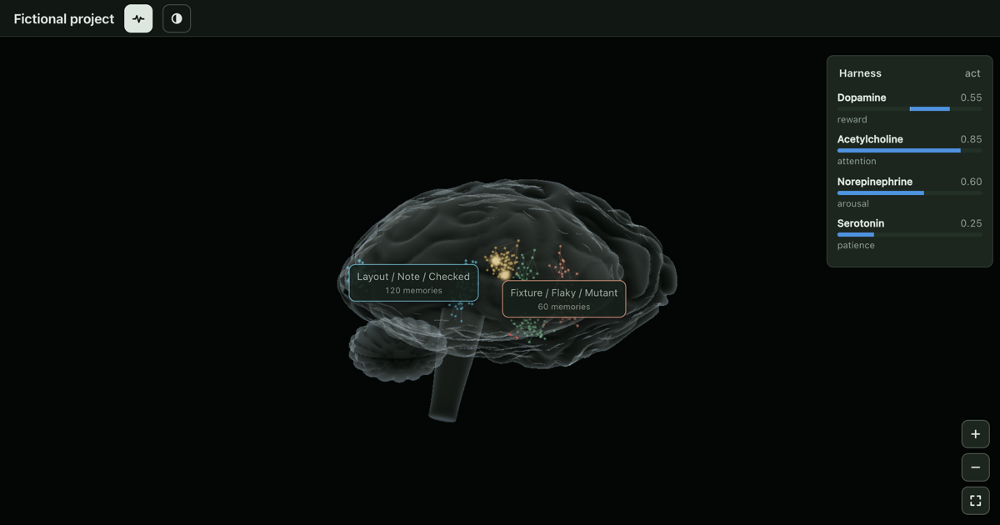

# memory-pulse-atlas

See your coding agent's memory as a brain you can turn in your hand: every note it kept, the links between them, and
every correction drawn in red over the notes it retired.



```bash
npx memory-pulse-atlas
```

Run it inside a project that has a memory ledger (`.memory-pulse/events.jsonl`). It writes `memory-atlas.html`, one
file of about 1.7 MB that opens in any browser, works with no network connection, and contains nothing but your
ledger and the viewer. Nothing is uploaded. The page's own security policy forbids it from making any network
request at all.

## What you see

- **The brain.** Each memory is a point inside a translucent brain. Memories about the same subject sit together and
  are coloured by region. Drag to turn it, scroll to zoom, click a point to read the note.
- **Corrections.** When your agent withdrew a value ("the refund window is 30 days" became "14 days"), the correction
  is a red diamond, and any later note that still carries the old value is ringed in red. Most memory tools show you
  what the agent knows. This one also shows what it was told to stop believing.
- **Time.** Press play and the memory grows in the order it was written. Drag the slider to see it as it stood on any
  earlier row.
- **Four views.** Map, River (the map laid out along time), List (a sortable table) and 3D.

## Install

You need Node 22 or later. There is nothing else to install and the package has no runtime dependencies.

```bash
npx memory-pulse-atlas                                  # the project's ledger -> memory-atlas.html
npx memory-pulse-atlas path/to/events.jsonl --open      # a ledger anywhere, opened when written
npx memory-pulse-atlas a.jsonl b.jsonl --title "Team"   # several ledgers in one brain
npx memory-pulse-atlas serve                            # a live page on 127.0.0.1:4747 that follows the ledger
```

With no file named, it reads `./.memory-pulse/events.jsonl`, then `$MEMORY_PULSE_LEDGER`. A ledger is JSON Lines, one
row per line, each with a whole-number `t`, a `cause` and an `effect`. `note`, `tags`, `kind: "correction"`,
`withdrawn` and `replacement` (a list, or one value as a string) are read when present. A line without the three
required fields is skipped, and the file, the line number and the reason are printed. `--strict` refuses the build instead. Lines are never dropped in silence.

`serve` listens on 127.0.0.1 only. It refuses requests that arrive under any other host name and refuses to be shown
inside another site's frame.

## The widget

`--embed` writes the brain alone, without the side panels, for a dashboard, a README site or an internal page:

```bash
npx memory-pulse-atlas --embed --out memory-atlas-embed.html
```

```html
<script type="module" src="https://unpkg.com/memory-pulse-atlas/src/widget.js"></script>
<memory-atlas-widget src="memory-atlas-embed.html" height="420"></memory-atlas-widget>
```

The widget is a sandboxed frame that may run its own scripts and nothing else. It cannot read the page around it, and
it cannot navigate the top window.

## The cognitive-harness layer (optional)

If your agent runs inside a harness that keeps neuromodulator levels, the atlas can show them as four gauges and
let them tint the brain:

| Level | Range | What the atlas does with it |
|---|---|---|
| Dopamine (reward) | -1 to 1 | memory halos brighten as it rises |
| Acetylcholine (attention) | 0 to 1 | the outer membrane thins so the memories stand out |
| Norepinephrine (arousal) | 0 to 1 | glow strength and the speed of the slow turn |
| Serotonin (patience) | 0 to 1 | slows the turn |

```bash
npx memory-pulse-atlas --mood-cmd "rain state"           # any command that prints the levels as JSON
npx memory-pulse-atlas serve --mood-cmd "rain state"     # the gauges refresh every 3 seconds
```

The command must print `{"DA": .., "ACh": .., "NE": .., "5HT": ..}`, or the same keys under `modulator`. This is a
picture of the harness's own numbers. The atlas does not compute or interpret them.

## Use it from code

```js
import { atlasFromLedgers, parseLedger, renderAtlasHtml } from "memory-pulse-atlas";
const rows = parseLedger(text, "events.jsonl");
const html = renderAtlasHtml(atlasFromLedgers([{ name: "events.jsonl", rows }]), { title: "My project" });
```

## Limits

- The layout groups memories by the words they share (TF-IDF and k-means). It does not understand meaning. Two notes
  about the same subject written in different words can land apart.
- 5,000 memories by default (`--max-notes` raises it). Above about 3,000, related notes are searched within a topic
  rather than across the whole memory. Measured 2026-11-18 on an M1 Pro laptop: a 4,637-row ledger took 9.7 seconds.
- In `serve`, every memory already on the map stays where it is when the ledger grows. A new memory joins the topic of
  the earlier memory it is most like and sits beside it. Once new memories outnumber half of the map, or when `serve`
  restarts, the whole map is laid out again. Rows added to the end of a ledger are folded in without a new layout, and
  only the new memories and new corrections are checked for withdrawn values: one added row took 0.14 seconds at 1,200
  memories and 0.4 seconds at 4,700, against 9 seconds or more for a layout (measured 2026-11-19, M1 Pro). An edited or deleted earlier row means a full layout. The server does not answer while it rebuilds.
- The 3-D view needs WebGL 2. Without it the page shows the flat map, river and list.
- Claude Code shows tool results as text. It does not display the widget inside the conversation, so open the page in
  a browser.

## Licence

MIT. See `LICENSE`. three.js is MIT and is bundled inside the page.
